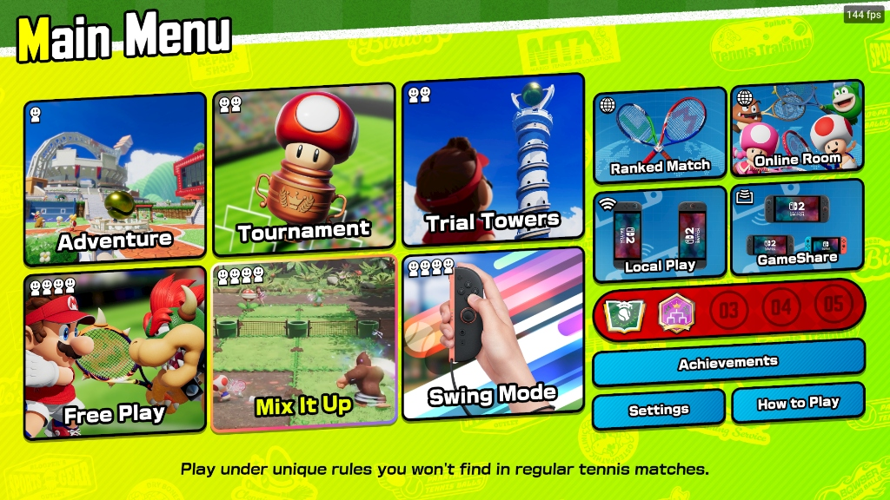
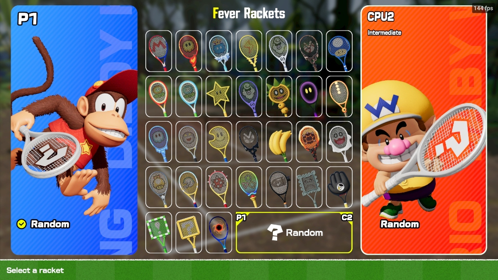
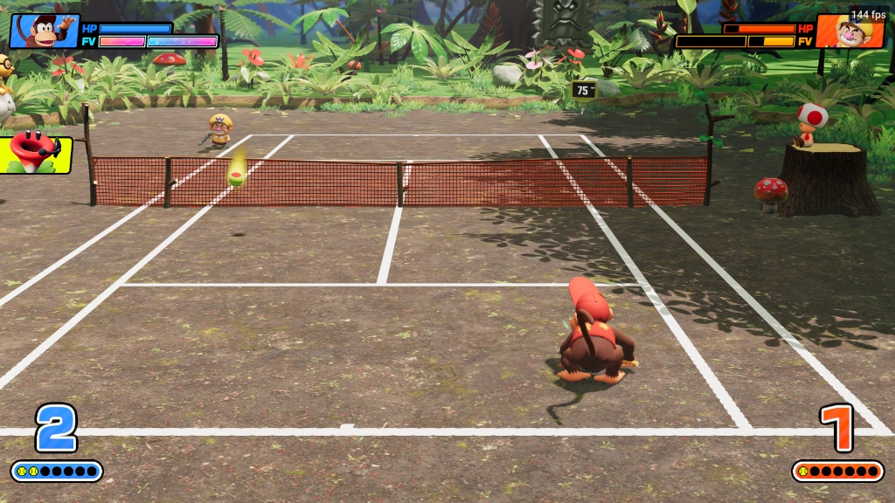
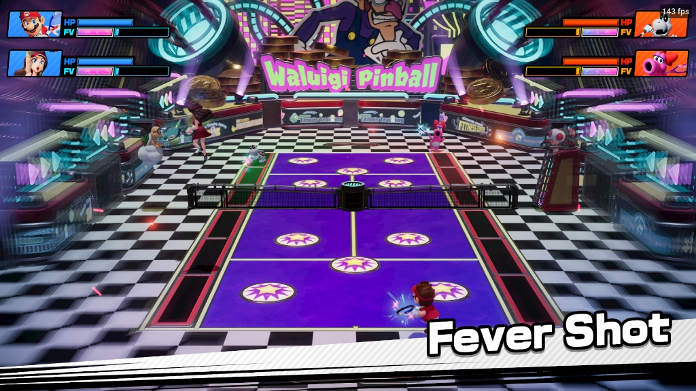

# MTF Recomp

[](https://recompstore.com/dev/rafael-fj)
<a href="https://recomplauncher.com"><picture><source media="(prefers-color-scheme: dark)" srcset="https://recomplauncher.com/assets/press/launcher/badge-light.svg"></picture></a>

Static recompilation of *Mario Tennis Fever* (Nintendo Switch 2, Update `1.1.1` / `v327680`, Title ID `0400D4201C6EA000`) into a native Windows `x86-64` application with a Vulkan 1.3 renderer.

> [!IMPORTANT]
> **Respect Copyright — No Game Files Included.**
> This repository and its releases contain **zero** copyrighted Nintendo/Camelot assets, game binaries, ROMs, `.nup` packages, encryption keys, or firmware.
> To build and play, you must supply your own legally obtained copy of *Mario Tennis Fever* (Update `1.1.1` / `v327680`). All code lifting, shader translation, and native compilation happen locally on your PC.
>
> MTF Recomp is an independent, non-commercial fan preservation project and is **not** affiliated with, endorsed, or sponsored by Nintendo Co., Ltd. or Camelot Software Planning. All trademarks belong to their respective owners.

---

## Screenshots

| Main Menu (144 FPS) | Fever Rackets Selection |
| :---: | :---: |
|  |  |

| Jungle Court | Waluigi Pinball (Fever Shot) |
| :---: | :---: |
|  |  |

---

## Status & Features

**Playable on Windows x86-64 (Vulkan 1.3).** Built on the `0.1.0+6caba99` (MIT) base fork of [kayochiaradia/mtf-recomp](https://github.com/kayochiaradia/mtf-recomp) with native PC enhancements:

- **Frame Rate & Frame Generation:** `60 FPS` native simulation, unlocked engine `FPS_LIMIT` (`30`–`Uncapped`), and optical-flow Frame Generation (`120`, monitor refresh e.g. `144 Hz`, or `unlimited`).
- **Resolution & Upscaling:** `720p`–`8K (4320p)`, smart `auto` matching your display, `50%`–`200%` render scale, AMD FSR 1, Bilinear, HDR10, and NVIDIA DLAA/DLSS.
- **Controls & Dynamic Prompts:** Plug-and-play SDL3 gamepad support (Nintendo Switch, Xbox, PlayStation), full keyboard/gamepad remapping (`F1 -> Controls`), and live-switching button prompt icons (Nintendo / Xbox / PlayStation / Keyboard).
- **In-Game Overlay (`F1` / `Esc` / `Minus+Plus`):** Dear ImGui settings menu in English and Brazilian Portuguese (`pt-BR`), performance monitor, and `F1 -> Cheats` (in-memory toggles to unlock characters, outfits, rackets, courts, and cups/modes for instant multiplayer without altering your save).
- **Multiplayer & Browser Remote Play (`F1 -> Multiplayer`):** Local multi-gamepad routing (`P1`–`P4`) plus built-in browser streaming (VP8 + Opus + remote controller input) so up to 4 friends can join from Chrome/Edge.
- **Automatic Update Alerts & RecompLauncher Support:** Includes `recomplauncher.json` (Levels 1–3) for one-click setup/updates in RecompLauncher, plus an in-game GitHub release checker (one-time 5s banner + `F1` menu reminder) for standalone players.

---

## Multiplayer & Browser Remote Play (`F1 -> Multiplayer`)

| Option | Transport | When to Use | Public IP Privacy | Expected Delay |
| :--- | :--- | :--- | :--- | :--- |
| **Local Host** | HTTP + WebSocket (direct LAN / port-forward) | Same local network (LAN/Wi-Fi) or trusted peers with zero tunnel overhead | Exposed if shared over WAN/port-forward (privacy warning shown) | **~15–35 ms** (LAN) |
| **Cloudflare (WebSocket)** | HTTP + WebSocket via `trycloudflare.com` tunnel | Playing over the internet when strict NAT/firewalls block UDP or you want a zero-config link | **Hidden** behind `trycloudflare.com` | **~45–90 ms** (depends on region/route) |
| **WebRTC (Low Latency UDP)** | WebRTC DataChannel (UDP) + automatic WebSocket fallback | Best responsiveness for online matches; falls back to WebSocket automatically if a peer's NAT blocks UDP | **Hidden** during signaling when `cloudflared.exe` is installed | **~25–55 ms** (direct UDP) |

- **Stream Quality Presets (`F1 -> Multiplayer`):** Switch live between **Performance** (`540p`, `2.2 Mbps`), **Balanced** (`720p`, `4.5 Mbps`, default), and **Quality** (`720p`, `7.5 Mbps`).
- **Notifications:** A 3-second banner notifies the host whenever a remote player connects or disconnects.
- **One-Click Tunnel Setup:** Install `cloudflared.exe` directly from `F1 -> Multiplayer` (**Install Cloudflare**).

---

## Default Controls & Shortcuts

All gameplay bindings can be customized in **`F1 -> Controls`**:

| Action | Default Keyboard | Gamepad |
| :--- | :--- | :--- |
| **Left Stick (Move / Aim)** | `W` `A` `S` `D` | Left Stick |
| **Right Stick** | Arrow Keys | Right Stick |
| **A / B / X / Y** | `K` / `J` / `I` / `U` | Face Buttons |
| **L / R** | `Q` / `E` | `L` / `R` (`LB` / `RB`) |
| **ZL / ZR** | `Z` / `C` | `ZL` / `ZR` (`LT` / `RT`) |
| **Plus (+) / Minus (-)** | `Enter` / `Backspace` | `Start` / `Select` |
| **Motion / Shake** | `Space` | Gyro / Shake |
| **Settings Menu** | `F1` or `Esc` | `Minus + Plus` |
| **Toggle Fullscreen** | `F11` | — |
| **Quit Game** | `Alt + F4` (or `F1 -> Quit`) | — |

---

## Quick Start

### Option A — RecompLauncher (Recommended)
1. Install [RecompLauncher](https://recomplauncher.com).
2. Add/install **Mario Tennis Fever: Recompiled** and point it to your extracted `Update 1.1.1 (v327680)` folder (`exefs/` and `romfs/`).
3. Configure graphics, cheats, and audio directly in the launcher and press **Play**.

### Option B — Windows Setup (`MTF-Recomp-v*-Windows-x64.zip`)
1. Download `MTF-Recomp-v*-Windows-x64.zip` from [GitHub Releases](https://github.com/rafael-fj/mtf-recompiled/releases) and extract it.
2. Run `MTF-Recomp-Setup.exe` (available in English and `pt-BR`).
3. Select your legal *Mario Tennis Fever* (`1.1.1`) `.nup` file or extracted `exefs`/`romfs` folder and choose your install folder.
4. Launch `mtf-recomp.exe` from the installed folder (`F1` / `Esc` opens the settings menu).

### Option C — Build from Source (`tools/build_fork.py`)
1. Enable the pre-commit content guard:
   ```powershell
   git config core.hooksPath .githooks
   ```
2. Copy `config.example.toml` to `config.local.toml` and set `[game].dump_path` to your extracted *Mario Tennis Fever + Update 1.1.1* folder.
3. Build cleanly with CMake + Ninja (`build/fork/bin/mtf-recomp.exe`):
   ```powershell
   python tools/build_fork.py
   ```
4. Verify no game content is staged/tracked:
   ```powershell
   python tools/check_content.py
   ```

---

## Found a Bug?

If you encounter a crash or rendering issue:
1. Check [docs/obstacles-and-quirks.md](docs/obstacles-and-quirks.md) to see if it is already documented.
2. Open an issue on [GitHub Issues](https://github.com/rafael-fj/mtf-recompiled/issues) and include:
   - Your **GPU model**, **driver version**, and **Windows version**.
   - Steps to reproduce the issue.
   - Your **`logs/mtf.log`** file (located next to `mtf-recomp.exe`) and `mtf.ini` if relevant.
   - **Never** upload game files, `.nup` archives, or encryption keys.

---

## Contributing & Documentation

Contributions are welcome! Please read [CONTRIBUTING.md](CONTRIBUTING.md) before opening a Pull Request.

- [docs/roadmap.md](docs/roadmap.md) — Step-by-step implementation roadmap (`F0`–`F9`)
- [docs/port-status.md](docs/port-status.md) — Subsystem status and verified targets
- [docs/devlog.md](docs/devlog.md) — Development and reverse-engineering log
- [docs/obstacles-and-quirks.md](docs/obstacles-and-quirks.md) — Known MTF-specific technical obstacles and solutions
- [docs/switch2-recomp-rag.md](docs/switch2-recomp-rag.md) — Cross-project Switch 2 recompilation RAG & license guide

## License & Credits

Project-owned code is licensed under the [MIT License](LICENSE). Originated from the `0.1.0+6caba99` (MIT) release of [kayochiaradia/mtf-recomp](https://github.com/kayochiaradia/mtf-recomp). All third-party components and attributions are listed in [THIRD_PARTY_NOTICES.md](THIRD_PARTY_NOTICES.md).
